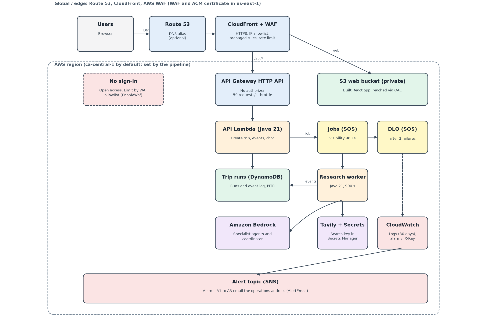

# VamsDest on AWS: infrastructure inventory

Everything the serverless stack (infra/template.yaml) creates, plus what it depends on and what it does not create. The stack deploys to a single AWS region. CloudFront, Route 53 and the WAF web ACL are global or us-east-1 services. The template creates no VPC, subnets, NAT gateway, load balancer or EC2 instances, so there are no availability zones to choose and no VPC firewall rules to manage. There is no sign-in. Protection comes from CloudFront, AWS WAF (when enabled), API Gateway throttling and IAM.

## 1. Components (in creation order of the template)

| ID | Component | AWS service | Configuration | Scope and AZ | Security | Notes |
|---|---|---|---|---|---|---|
| C01 | DNS record for the app | Route 53 | A and AAAA alias to CloudFront (only if AppDomainName is set) | Global | DNS only | Uses an existing public hosted zone (HostedZoneId). |
| C02 | TLS certificate | AWS Certificate Manager | Covers AppDomainName. Used by CloudFront with TLSv1.2_2021 | us-east-1 only | TLS 1.2 minimum | Created outside this stack. CloudFront requires us-east-1. |
| C03 | Web and API edge | Amazon CloudFront | PriceClass_100. HTTP/2 and HTTP/3, IPv6. Default behavior serves the web app from S3. /api/* goes to API Gateway with caching off | Global (edge locations) | Redirect HTTP to HTTPS for web. HTTPS only to the API origin | Origin Access Control to S3 (C07). |
| C04 | Security response headers | CloudFront response headers policy | HSTS 1 year with subdomains, nosniff, frame DENY, strict-origin-when-cross-origin, CSP | Global | Browser hardening | Content Security Policy from the template. |
| C05 | Web application firewall | AWS WAF (CLOUDFRONT scope) | Rule 0 block any IP not in the allowlist. Rule 1 AWS Common Rule Set. Rule 2 Known Bad Inputs. Rule 3 rate limit of 2000 requests per 5 minutes per IP. Default action allow | Global. Must be created in us-east-1 | Enabled only when EnableWaf=true | With AllowedCidrs empty, every IP is blocked. |
| C06 | Allowlist IP sets | AWS WAF IP sets | IPv4 set and IPv6 set, both from template parameters | Global (us-east-1) | Access control at the edge | Used by C05. |
| C07 | Web app bucket | Amazon S3 | Private. Block all public access. SSE-S3 (AES256). Versioning on. BucketOwnerEnforced. Bucket policy allows only CloudFront and denies non-TLS | Regional bucket | Encrypted at rest. Enforces TLS | Holds the built React app: index.html (no-cache) and assets (immutable). |
| C08 | CloudFront access to S3 | CloudFront Origin Access Control | sigv4, always signed | Global | Only CloudFront can read C07 | No public bucket URLs. |
| C09 | HTTP API | Amazon API Gateway (HTTP API, $default stage) | No authorizer on any route. Default throttle 50 requests/s with burst 100. Routes: POST /api/trips, GET /api/trips/{tripId}/events, POST /api/trips/{tripId}/chat | Regional | No sign-in. Anyone who can reach the URL can create trips | No authorizer: the API is open to any caller. |
| C10 | API function | AWS Lambda (Java 21, x86_64) | 512 MB. 10 s timeout. X-Ray tracing active. Handler ApiHandler | Regional. AWS spreads the function across AZs | No caller identity: all trips share one owner | Creates runs, serves polled events, queues chat questions. |
| C11 | Research worker | AWS Lambda (Java 21, x86_64) | 1024 MB. 900 s timeout. X-Ray tracing. Batch size 1. Maximum concurrency set by WorkerConcurrency (default 5) | Regional. AWS spreads the function across AZs | Reads the Tavily key from C19. Calls Bedrock (C20) | Runs the four specialist agents and the coordinator, which bounds Bedrock and Tavily spend. |
| C12 | Job queue | Amazon SQS (standard) | Visibility timeout 960 s. Retention 4 days. SSE-SQS. Redrive to C13 after 3 receives | Regional, managed across AZs | SSE-SQS encryption | Longer visibility than the worker timeout, so a running job is not redelivered. |
| C13 | Dead-letter queue | Amazon SQS | Retention 14 days. SSE-SQS | Regional | SSE-SQS encryption | Messages here trigger alarm A1. |
| C14 | Trip runs table | Amazon DynamoDB | On-demand. Keys pk and sk. TTL on expiresAt (RUN_TTL_HOURS, default 24). Point-in-time recovery on. SSE on. Deletion protection in prod | Regional, replicated across 3 AZs by DynamoDB | Encrypted at rest. IAM access only | Stores each run and its event log. |
| C15 | Log groups | Amazon CloudWatch Logs | One group each for the API function and worker. Retention 30 days | Regional | The API and worker log errors, not request bodies | Look here first for worker errors and failed API calls. |
| C16 | Alert topic | Amazon SNS (topic) | Receives alarms A1 to A3. Optional email subscription from AlertEmail | Regional | Topic policy default | Empty AlertEmail creates the topic with no subscriber. |
| C17 | Alarms | Amazon CloudWatch alarms | A1 dead-letter queue has messages (more than 0 in 5 min). A2 worker errors (3 or more in 5 min). A3 API 5xx (5 or more in 5 min) | Regional | Alarm actions go to C16 | Treat missing data as not breaching. |
| C18 | Execution roles | AWS IAM roles (created by SAM) | One role each for C10, C11 and C17. Each policy is limited to the table, queue or secret it needs | Global (IAM) | Deployment needs CAPABILITY_IAM | The worker may invoke the Bedrock model in any region through an inference profile (wildcard). |
| C19 | Search API key | AWS Secrets Manager (created outside the stack) | Holds the Tavily API key. Its ARN is passed as TavilySecretArn | Regional | Read only by the worker role | Not stored in GitHub or in the repository. |
| C20 | Language model | Amazon Bedrock | Model from BedrockModelId. Template default ca.amazon.nova-lite-v1:0. Optional guardrail (ID and version) | Regional (model access is enabled per account and region) | Worker role allows InvokeModel and ApplyGuardrail only | Docs suggest a Claude model. Confirm model access in the console before deploying. |
| C21 | Deploy pipeline | GitHub Actions with AWS OIDC role | Builds and tests the app. cfn-lint on the template. sam deploy. scripts/deploy-web.sh publishes the web app and invalidates CloudFront | Outside AWS runtime | No long-lived AWS keys. Role from AWS_DEPLOY_ROLE_ARN | Smoke test expects 401 from an unauthenticated API call. |

## 2. What the stack does not create

| Item | Status |
|---|---|
| VPC, subnets, route tables | Lambda, DynamoDB, SQS, SNS and S3 run on AWS-managed networking. No private subnets or private database. |
| NAT gateway, internet gateway | Not created. The functions reach Bedrock, SNS and Tavily over public AWS endpoints, secured with IAM. |
| Security groups, network ACLs | Not created. There are no VPC-attached resources to protect. |
| VPC endpoints, PrivateLink | Not created. Add them if the functions are moved into a VPC. |
| Load balancer | Not created. CloudFront is the entry point. |
| EC2 instances, Auto Scaling | Not created. All compute is Lambda. |
| AWS Network Firewall, Shield Advanced | Not created. |
| Customer-managed KMS keys | Not created. Encryption uses AWS-owned or AWS-managed keys (SSE-S3, SSE-SQS, DynamoDB default). |
| Availability zones | Not chosen in the template. Lambda, DynamoDB, SQS, SNS, S3 and API Gateway are managed by AWS across AZs in the region. |

## 3. Data flows

- **Load the web app.** Browser to CloudFront, which reads from S3 (C07) through Origin Access Control (C08). index.html is never cached.
- **Plan a trip.** Browser to CloudFront (C03), then /api/* to API Gateway (C09). No sign-in is checked. The API function (C10) writes a run to C14 and queues a job in C12. The worker (C11) reads the job, calls Bedrock (C20) and Tavily (C19), writes each event to C14, and sets the run to completed or partial. The browser polls the events.
- **Failed job.** SQS retries the job up to 3 times, then moves it to the dead-letter queue (C13). Alarm A1 fires and emails the alert topic (C16).

## 4. Security controls

- There is no sign-in. The API and web app are open to anyone who can reach the CloudFront URL, unless the WAF allowlist is enabled.
- The web app bucket is private and reachable only through CloudFront. Insecure transport is denied.
- Security headers (HSTS, CSP, frame DENY, nosniff) are set at the edge.
- WAF (when enabled) blocks every IP outside the allowlist, and adds AWS managed rules and a per-IP rate limit.
- Deploys use GitHub OIDC, not stored AWS keys.
- Encryption at rest is on for DynamoDB, SQS and S3. Point-in-time recovery is on for the runs table. Production tables have deletion protection.

## 5. Risks and open items

1. No sign-in. Anyone with the URL can create trips, which spends Bedrock and Tavily budget. Enable the WAF allowlist (EnableWaf=true with AllowedCidrs) or add authentication before sharing the URL publicly.
2. WAF location. The WAF web ACL uses CLOUDFRONT scope and must be created in us-east-1. samconfig.toml deploys to ca-central-1 by default, so EnableWaf=true will fail there. Set the pipeline region to us-east-1, or disable the WAF in that region.
3. Region mismatch in docs. samconfig.toml uses ca-central-1. The guides in docs/ say us-east-1. Pick one and set AWS_REGION to match the Bedrock model access you enabled.
4. CFN lint. cfn-lint reports errors on the WAF IPSetReferenceStatement properties (ARN and Arn spelling, lines 510 to 513 of infra/template.yaml). CI runs cfn-lint, so the deploy job will not pass until this is resolved. This block was already uncommitted before these changes. It has not been fixed here because the correct property spelling needs confirming against the current CloudFormation spec.
5. No VPC. Functions and tables are reached over public AWS endpoints. This is fine for the current design, but a private network would need a VPC, endpoints and a NAT gateway.
6. The Bedrock model. The template default is a Nova model, and the guides suggest a Claude model. Confirm the model ID and access in the account before the first trip.
7. Legacy EKS path. deploy/k8s and docs/DEPLOY-EKS-VASOLAI.md still describe an OIDC sign-in that no longer exists. The Spring prod profile is open. CI does not deploy this path.

## 6. Legacy EKS path

Not part of the Lambda stack. docs/DEPLOY-EKS-VASOLAI.md describes an alternative in which eksctl creates a VPC (public and private subnets across the AZs it selects, a NAT gateway, and an EKS cluster with managed EC2 nodes). An internet-facing AWS Load Balancer Controller creates an Application Load Balancer and its security groups from deploy/k8s/ingress.yaml, with an ACM certificate in the cluster region. The WAF annotation is commented out. This path needs its own VPC inventory, which is not included here.
